# Report: runs/main

Local subset results, not full-benchmark VQA server scores.

## Calibration
```
{
 "rule": "scale = mean||text token embedding||_2 (training prompts+targets) / mean||connector output||_2 at init (training images); fixed scalar buffer",
 "n_examples": 256,
 "text_mean_l2": 0.8746779561042786,
 "connector_mean_l2_before": 15.955412864685059,
 "scale": 0.0548201393171247,
 "connector_mean_l2_after": 0.8746780157089233
}
```

## Learning curves
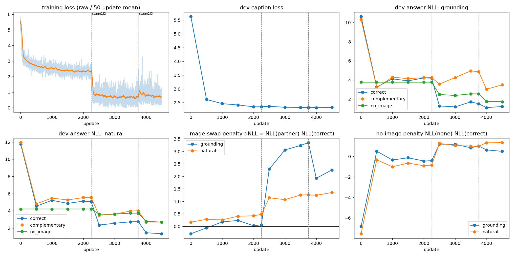
(dashed lines = stage boundaries)

## Final test: grounding suite (64 pairs / 128 questions)

Accuracy / pair-acc / identical / empty in %, with 95% pair-bootstrap CI (4000 resamples). NLL = mean token NLL of the original reference (teacher-forced, no end token). Natural accuracy = VQA soft consensus.


**all** (64 pairs)

| condition | accuracy | pair acc | identical ans. | empty | ref. NLL | gen s/answer |
|---|---|---|---|---|---|---|
| correct | 64.06 [55.47, 72.66] | 42.19 [31.25, 54.69] | 28.12 [17.19, 39.06] | 0.00 [0.00, 0.00] | 1.049 [0.792, 1.342] | 0.0379 |
| complementary | 14.84 [9.38, 20.31] | 0.00 [0.00, 0.00] | 28.12 [17.19, 39.06] | 0.00 [0.00, 0.00] | 4.186 [3.621, 4.763] | 0.0353 |
| mismatched | 36.72 [28.91, 44.53] | 10.94 [4.69, 18.75] | 62.50 [50.00, 73.48] | 0.00 [0.00, 0.00] | 2.648 [2.260, 3.054] | 0.0381 |
| no_image | 38.28 [32.81, 42.97] | 0.00 [0.00, 0.00] | 100.00 [100.00, 100.00] | 0.00 [0.00, 0.00] | 1.764 [1.551, 1.994] | 0.0183 |

Correct-image advantage over complementary swap: accuracy 49.22 [37.50, 60.94] pts; pair accuracy 42.19 [31.25, 54.69] pts; NLL (complementary - correct) 3.137 [2.409, 3.850].

| condition | n | matches own ref | matches partner ref | neither |
|---|---|---|---|---|
| correct | 128 | 82 | 19 | 27 |
| complementary | 128 | 19 | 82 | 27 |
| mismatched | 128 | 47 | 47 | 34 |
| no_image | 128 | 49 | 49 | 30 |

**presence** (32 pairs)

| condition | accuracy | pair acc | identical ans. | empty | ref. NLL | gen s/answer |
|---|---|---|---|---|---|---|
| correct | 87.50 [79.69, 93.75] | 75.00 [59.38, 87.50] | 25.00 [12.50, 40.62] | 0.00 [0.00, 0.00] | 0.623 [0.249, 1.079] | 0.0379 |
| complementary | 12.50 [6.25, 20.31] | 0.00 [0.00, 0.00] | 25.00 [12.50, 40.62] | 0.00 [0.00, 0.00] | 5.119 [4.325, 5.872] | 0.0353 |
| mismatched | 51.56 [42.19, 60.94] | 15.62 [3.12, 28.12] | 71.88 [56.25, 87.50] | 0.00 [0.00, 0.00] | 2.529 [1.965, 3.104] | 0.0381 |
| no_image | 50.00 [50.00, 50.00] | 0.00 [0.00, 0.00] | 100.00 [100.00, 100.00] | 0.00 [0.00, 0.00] | 1.397 [1.175, 1.628] | 0.0183 |

Correct-image advantage over complementary swap: accuracy 75.00 [59.38, 87.50] pts; pair accuracy 75.00 [59.38, 87.50] pts; NLL (complementary - correct) 4.496 [3.352, 5.512].

| condition | n | matches own ref | matches partner ref | neither |
|---|---|---|---|---|
| correct | 64 | 56 | 8 | 0 |
| complementary | 64 | 8 | 56 | 0 |
| mismatched | 64 | 33 | 31 | 0 |
| no_image | 64 | 32 | 32 | 0 |

**counting** (32 pairs)

| condition | accuracy | pair acc | identical ans. | empty | ref. NLL | gen s/answer |
|---|---|---|---|---|---|---|
| correct | 40.62 [29.69, 50.00] | 9.38 [0.00, 21.88] | 31.25 [15.62, 46.88] | 0.00 [0.00, 0.00] | 1.475 [1.192, 1.791] | 0.0379 |
| complementary | 17.19 [9.38, 25.00] | 0.00 [0.00, 0.00] | 31.25 [15.62, 46.88] | 0.00 [0.00, 0.00] | 3.253 [2.591, 4.014] | 0.0353 |
| mismatched | 21.88 [12.50, 32.81] | 6.25 [0.00, 15.62] | 53.12 [34.38, 68.75] | 0.00 [0.00, 0.00] | 2.768 [2.281, 3.294] | 0.0381 |
| no_image | 26.56 [17.19, 35.94] | 0.00 [0.00, 0.00] | 100.00 [100.00, 100.00] | 0.00 [0.00, 0.00] | 2.131 [1.820, 2.478] | 0.0183 |

Correct-image advantage over complementary swap: accuracy 23.44 [7.81, 39.06] pts; pair accuracy 9.38 [0.00, 21.88] pts; NLL (complementary - correct) 1.778 [1.118, 2.467].

| condition | n | matches own ref | matches partner ref | neither |
|---|---|---|---|---|
| correct | 64 | 26 | 11 | 27 |
| complementary | 64 | 11 | 26 | 27 |
| mismatched | 64 | 14 | 16 | 34 |
| no_image | 64 | 17 | 17 | 30 |

## Final test: natural suite (96 pairs / 192 questions)

Accuracy / pair-acc / identical / empty in %, with 95% pair-bootstrap CI (4000 resamples). NLL = mean token NLL of the original reference (teacher-forced, no end token). Natural accuracy = VQA soft consensus.


**all** (96 pairs)

| condition | accuracy | pair acc | identical ans. | empty | ref. NLL | gen s/answer |
|---|---|---|---|---|---|---|
| correct | 54.53 [48.02, 61.25] | 23.96 [15.62, 33.33] | 47.92 [38.54, 58.33] | 0.00 [0.00, 0.00] | 1.513 [1.213, 1.847] | 0.0436 |
| complementary | 30.78 [25.36, 36.61] | 2.08 [0.00, 5.21] | 47.92 [38.54, 58.33] | 0.00 [0.00, 0.00] | 2.799 [2.380, 3.264] | 0.0423 |
| mismatched | 30.31 [24.79, 35.73] | 2.08 [0.00, 5.21] | 54.17 [43.75, 64.58] | 0.00 [0.00, 0.00] | 2.593 [2.205, 3.011] | 0.0433 |
| no_image | 33.91 [28.59, 39.32] | 0.00 [0.00, 0.00] | 100.00 [100.00, 100.00] | 0.00 [0.00, 0.00] | 2.469 [2.076, 2.890] | 0.0198 |

Correct-image advantage over complementary swap: accuracy 23.75 [14.27, 33.12] pts; pair accuracy 21.88 [12.50, 31.25] pts; NLL (complementary - correct) 1.285 [0.949, 1.645].

| condition | n | matches own ref | matches partner ref | neither |
|---|---|---|---|---|
| correct | 192 | 99 | 51 | 42 |
| complementary | 192 | 51 | 99 | 42 |
| mismatched | 192 | 54 | 58 | 80 |
| no_image | 192 | 60 | 60 | 72 |

**yes/no** (36 pairs)

| condition | accuracy | pair acc | identical ans. | empty | ref. NLL | gen s/answer |
|---|---|---|---|---|---|---|
| correct | 64.31 [56.94, 71.67] | 22.22 [8.33, 36.11] | 75.00 [61.11, 88.89] | 0.00 [0.00, 0.00] | 0.812 [0.689, 0.936] | 0.0436 |
| complementary | 48.19 [40.83, 55.14] | 2.78 [0.00, 8.33] | 75.00 [61.11, 88.89] | 0.00 [0.00, 0.00] | 1.203 [1.035, 1.399] | 0.0423 |
| mismatched | 50.97 [44.44, 57.50] | 5.56 [0.00, 13.89] | 86.11 [75.00, 97.22] | 0.00 [0.00, 0.00] | 1.280 [1.052, 1.529] | 0.0433 |
| no_image | 51.39 [45.97, 55.83] | 0.00 [0.00, 0.00] | 100.00 [100.00, 100.00] | 0.00 [0.00, 0.00] | 1.281 [1.143, 1.437] | 0.0198 |

Correct-image advantage over complementary swap: accuracy 16.11 [3.46, 29.45] pts; pair accuracy 19.44 [5.56, 33.33] pts; NLL (complementary - correct) 0.391 [0.140, 0.665].

| condition | n | matches own ref | matches partner ref | neither |
|---|---|---|---|---|
| correct | 72 | 43 | 29 | 0 |
| complementary | 72 | 29 | 43 | 0 |
| mismatched | 72 | 34 | 36 | 2 |
| no_image | 72 | 34 | 34 | 4 |

**number** (24 pairs)

| condition | accuracy | pair acc | identical ans. | empty | ref. NLL | gen s/answer |
|---|---|---|---|---|---|---|
| correct | 46.88 [33.54, 60.00] | 16.67 [4.17, 33.33] | 33.33 [16.67, 54.17] | 0.00 [0.00, 0.00] | 1.843 [1.362, 2.440] | 0.0436 |
| complementary | 27.50 [17.08, 38.33] | 0.00 [0.00, 0.00] | 33.33 [16.67, 54.17] | 0.00 [0.00, 0.00] | 3.341 [2.751, 3.996] | 0.0423 |
| mismatched | 22.08 [12.29, 31.25] | 0.00 [0.00, 0.00] | 50.00 [29.17, 70.83] | 0.00 [0.00, 0.00] | 2.815 [2.209, 3.454] | 0.0433 |
| no_image | 31.67 [21.88, 40.83] | 0.00 [0.00, 0.00] | 100.00 [100.00, 100.00] | 0.00 [0.00, 0.00] | 2.389 [1.747, 3.202] | 0.0198 |

Correct-image advantage over complementary swap: accuracy 19.38 [0.00, 38.75] pts; pair accuracy 16.67 [4.17, 33.33] pts; NLL (complementary - correct) 1.497 [1.047, 1.977].

| condition | n | matches own ref | matches partner ref | neither |
|---|---|---|---|---|
| correct | 48 | 21 | 12 | 15 |
| complementary | 48 | 12 | 21 | 15 |
| mismatched | 48 | 10 | 12 | 26 |
| no_image | 48 | 14 | 14 | 20 |

**other** (36 pairs)

| condition | accuracy | pair acc | identical ans. | empty | ref. NLL | gen s/answer |
|---|---|---|---|---|---|---|
| correct | 49.86 [37.36, 62.50] | 30.56 [16.67, 47.22] | 30.56 [16.67, 47.22] | 0.00 [0.00, 0.00] | 1.994 [1.332, 2.836] | 0.0436 |
| complementary | 15.56 [7.78, 24.45] | 2.78 [0.00, 8.33] | 30.56 [16.67, 47.22] | 0.00 [0.00, 0.00] | 4.033 [3.223, 4.910] | 0.0423 |
| mismatched | 15.14 [8.19, 23.06] | 0.00 [0.00, 0.00] | 25.00 [11.11, 38.89] | 0.00 [0.00, 0.00] | 3.759 [3.029, 4.531] | 0.0433 |
| no_image | 17.92 [10.14, 26.53] | 0.00 [0.00, 0.00] | 100.00 [100.00, 100.00] | 0.00 [0.00, 0.00] | 3.710 [2.971, 4.550] | 0.0198 |

Correct-image advantage over complementary swap: accuracy 34.31 [18.06, 50.56] pts; pair accuracy 27.78 [11.11, 44.44] pts; NLL (complementary - correct) 2.039 [1.300, 2.805].

| condition | n | matches own ref | matches partner ref | neither |
|---|---|---|---|---|
| correct | 72 | 35 | 10 | 27 |
| complementary | 72 | 10 | 35 | 27 |
| mismatched | 72 | 10 | 10 | 52 |
| no_image | 72 | 12 | 12 | 48 |
## Qualitative complementary-image examples

Selection rule (deterministic, no cherry-picking by appearance): within each suite,
pairs are sorted by pair_id and the first k satisfying each category are shown:
  A 'follows image': correct-image predictions right for both questions AND under the
    complementary swap each prediction equals the partner image's reference;
  B 'ignores image': identical predictions for both images of the pair (correct condition);
  C 'fails': at least one wrong prediction under the correct image.

### grounding - A follows image (27 qualifying pairs; showing 3)

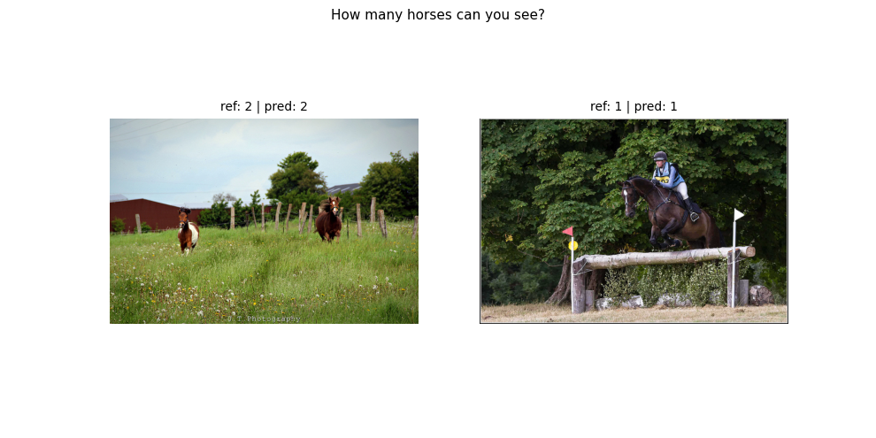

Question: *How many horses can you see?*

| item | reference | correct | complementary | mismatched | no image |
|---|---|---|---|---|---|
| image A | 2 | 2 | 1 | 3 | 1 |
| image B | 1 | 1 | 2 | 2 | 1 |


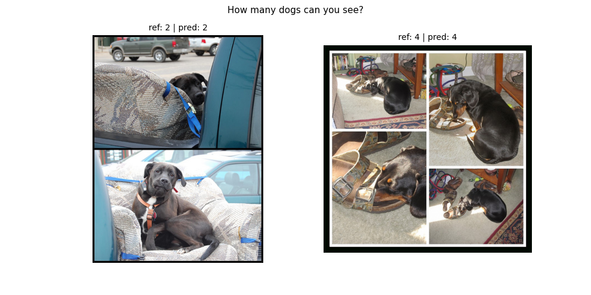

Question: *How many dogs can you see?*

| item | reference | correct | complementary | mismatched | no image |
|---|---|---|---|---|---|
| image A | 2 | 2 | 4 | 3 | 1 |
| image B | 4 | 4 | 2 | 0 | 1 |


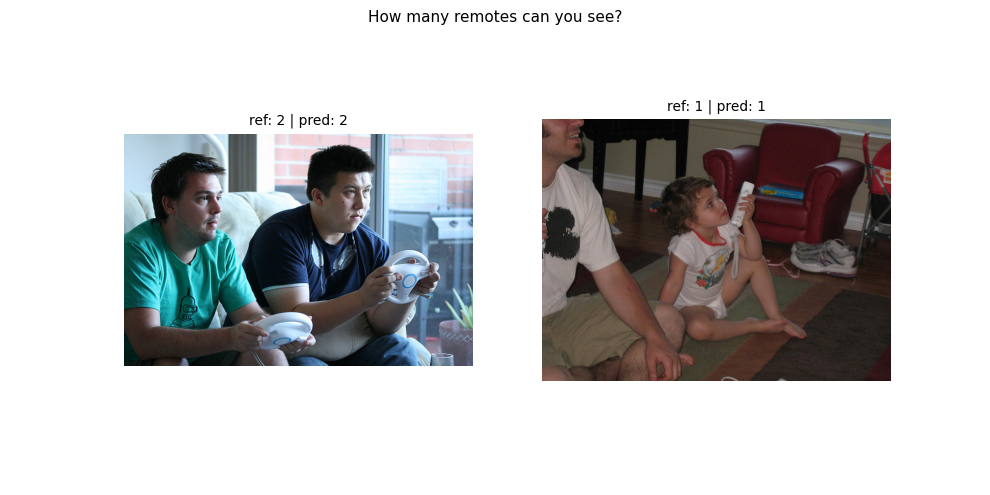

Question: *How many remotes can you see?*

| item | reference | correct | complementary | mismatched | no image |
|---|---|---|---|---|---|
| image A | 2 | 2 | 1 | 2 | 1 |
| image B | 1 | 1 | 2 | 2 | 1 |

### grounding - B ignores image (18 qualifying pairs; showing 3)

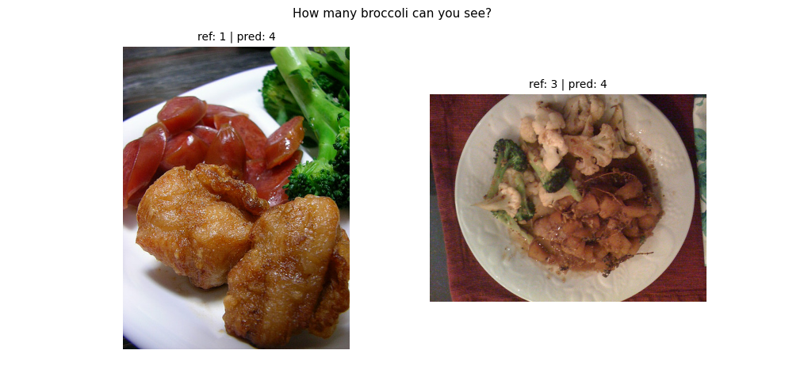

Question: *How many broccoli can you see?*

| item | reference | correct | complementary | mismatched | no image |
|---|---|---|---|---|---|
| image A | 1 | 4 | 4 | 1 | 1 |
| image B | 3 | 4 | 4 | 2 | 1 |


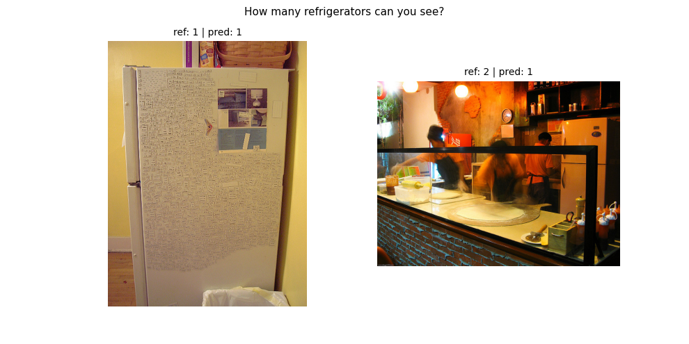

Question: *How many refrigerators can you see?*

| item | reference | correct | complementary | mismatched | no image |
|---|---|---|---|---|---|
| image A | 1 | 1 | 1 | 1 | 1 |
| image B | 2 | 1 | 1 | 1 | 1 |


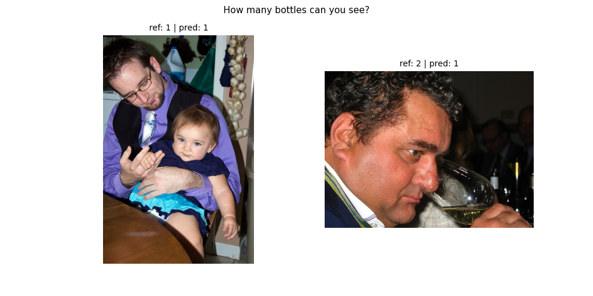

Question: *How many bottles can you see?*

| item | reference | correct | complementary | mismatched | no image |
|---|---|---|---|---|---|
| image A | 1 | 1 | 1 | 3 | 1 |
| image B | 2 | 1 | 1 | 3 | 1 |

### grounding - C fails (37 qualifying pairs; showing 3)

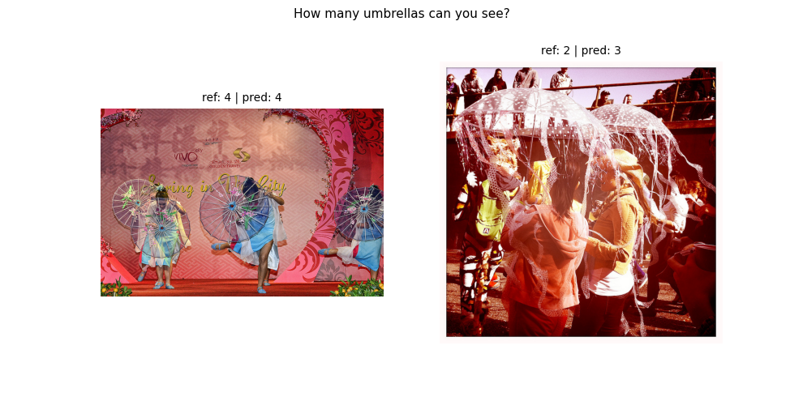

Question: *How many umbrellas can you see?*

| item | reference | correct | complementary | mismatched | no image |
|---|---|---|---|---|---|
| image A | 4 | 4 | 3 | 3 | 1 |
| image B | 2 | 3 | 4 | 1 | 1 |


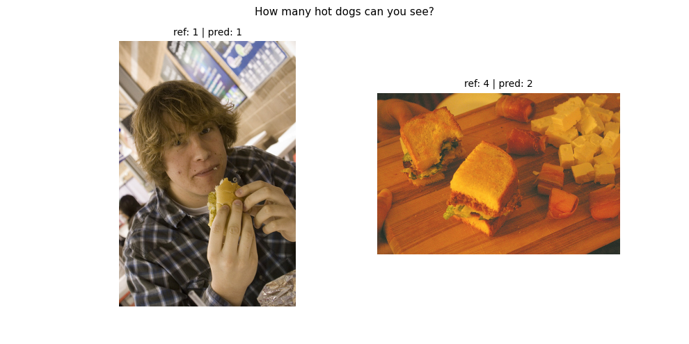

Question: *How many hot dogs can you see?*

| item | reference | correct | complementary | mismatched | no image |
|---|---|---|---|---|---|
| image A | 1 | 1 | 2 | 1 | 1 |
| image B | 4 | 2 | 1 | 3 | 1 |


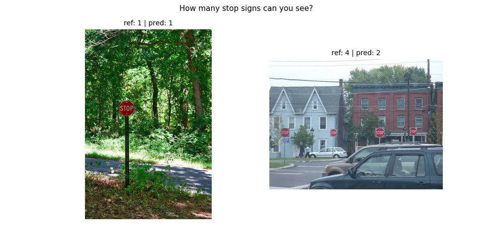

Question: *How many stop signs can you see?*

| item | reference | correct | complementary | mismatched | no image |
|---|---|---|---|---|---|
| image A | 1 | 1 | 2 | 3 | 1 |
| image B | 4 | 2 | 1 | 3 | 1 |

### natural - A follows image (23 qualifying pairs; showing 3)

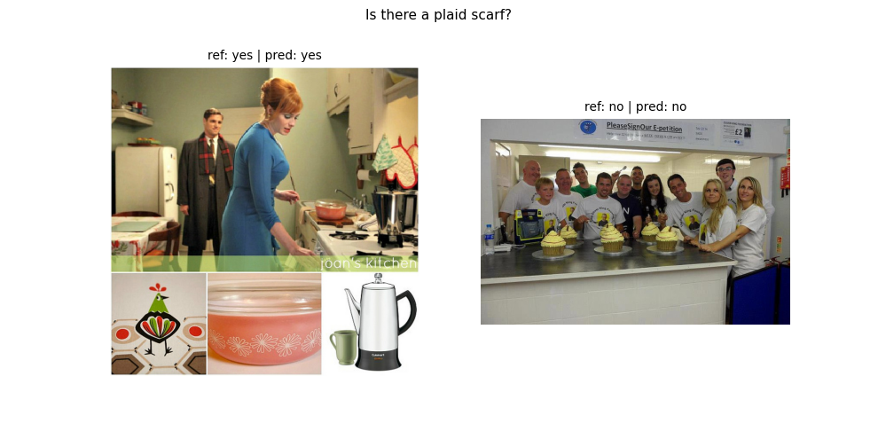

Question: *Is there a plaid scarf?*

| item | reference | correct | complementary | mismatched | no image |
|---|---|---|---|---|---|
| image A | yes | yes | no | no | no |
| image B | no | no | yes | no | no |


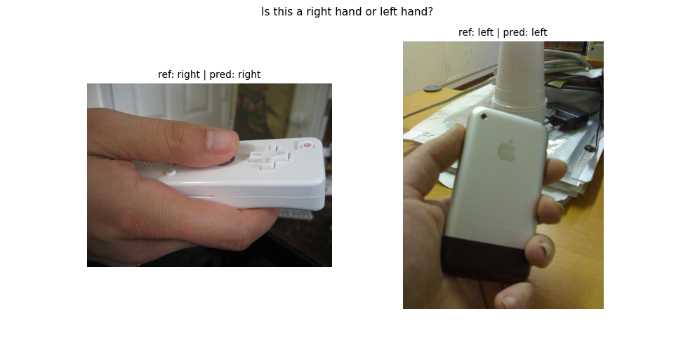

Question: *Is this a right hand or left hand?*

| item | reference | correct | complementary | mismatched | no image |
|---|---|---|---|---|---|
| image A | right | right | left | left | right |
| image B | left | left | right | right | right |


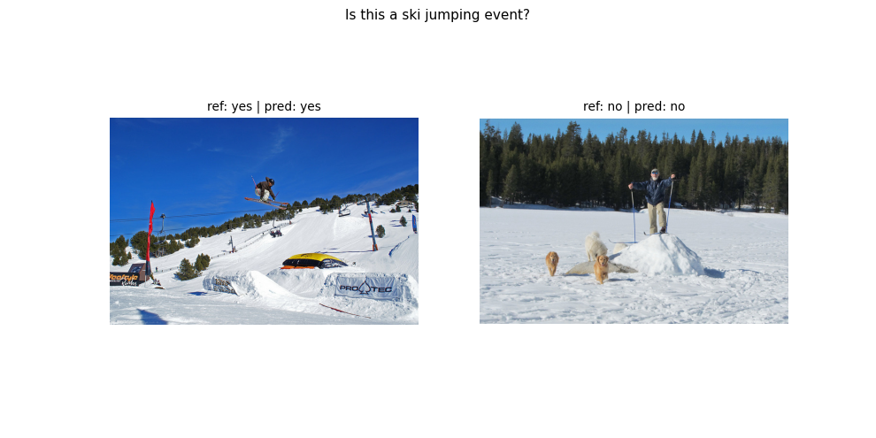

Question: *Is this a ski jumping event?*

| item | reference | correct | complementary | mismatched | no image |
|---|---|---|---|---|---|
| image A | yes | yes | no | no | no |
| image B | no | no | yes | no | no |

### natural - B ignores image (46 qualifying pairs; showing 3)

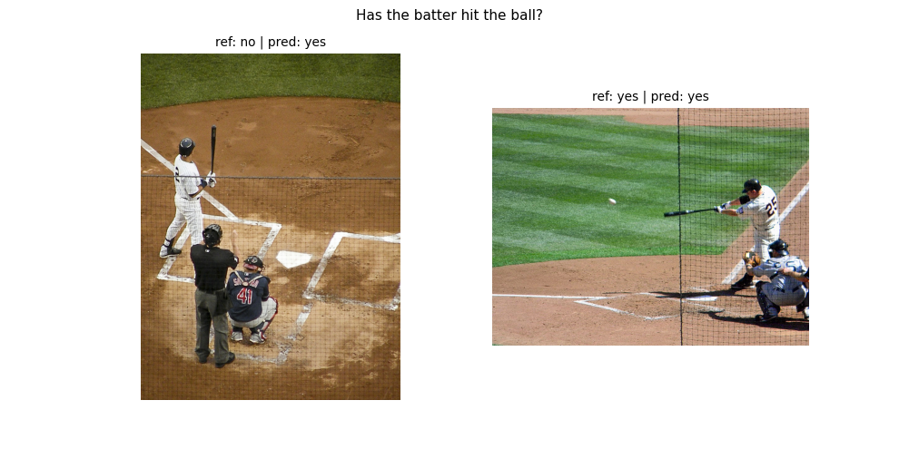

Question: *Has the batter hit the ball?*

| item | reference | correct | complementary | mismatched | no image |
|---|---|---|---|---|---|
| image A | no | yes | yes | no | no |
| image B | yes | yes | yes | no | no |


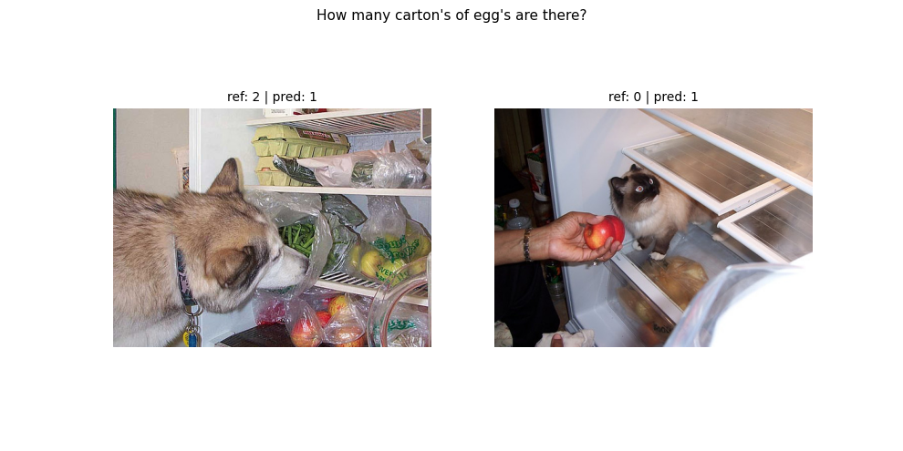

Question: *How many carton's of egg's are there?*

| item | reference | correct | complementary | mismatched | no image |
|---|---|---|---|---|---|
| image A | 2 | 1 | 1 | 0 | 1 |
| image B | 0 | 1 | 1 | 0 | 1 |


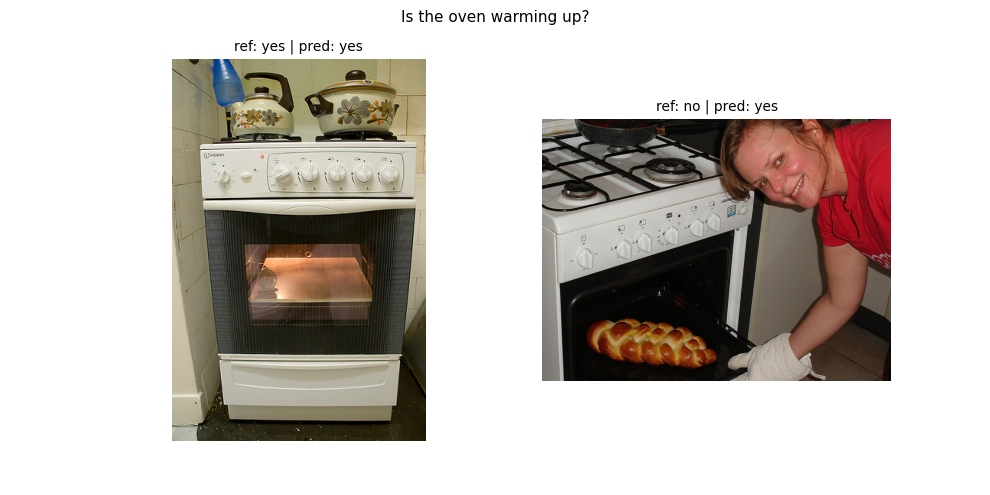

Question: *Is the oven warming up?*

| item | reference | correct | complementary | mismatched | no image |
|---|---|---|---|---|---|
| image A | yes | yes | yes | no | no |
| image B | no | yes | yes | no | no |

### natural - C fails (73 qualifying pairs; showing 3)


Question: *Has the batter hit the ball?*

| item | reference | correct | complementary | mismatched | no image |
|---|---|---|---|---|---|
| image A | no | yes | yes | no | no |
| image B | yes | yes | yes | no | no |


Question: *How many carton's of egg's are there?*

| item | reference | correct | complementary | mismatched | no image |
|---|---|---|---|---|---|
| image A | 2 | 1 | 1 | 0 | 1 |
| image B | 0 | 1 | 1 | 0 | 1 |


Question: *Is the oven warming up?*

| item | reference | correct | complementary | mismatched | no image |
|---|---|---|---|---|---|
| image A | yes | yes | yes | no | no |
| image B | no | yes | yes | no | no |

## Resources

- Feature caching (separate from training): 94 s, peak GPU 0.69 GB, 8729+528 images.

| stage | trainable params | training s | peak GPU GB |
|---|---|---|---|
| 1 | 1,837,056 (connector 1,837,056, LoRA 0) | 2859 | 2.52 |
| 2 | 6,424,576 (connector 1,837,056, LoRA 4,587,520) | 2282 | 2.51 |
| 3 | 6,424,576 (connector 1,837,056, LoRA 4,587,520) | 1150 | 2.45 |

Dev-evaluation time during training: 115 s.
Final evaluation: 78 s wall, peak GPU 1.91 GB.

## Analysis notes (fill in after reading the tables above)
- Image use: compare correct vs complementary / mismatched / no-image accuracy and NLL.
- Answer consistency: identical-answer rate and the own/partner/neither table show whether a swap moves predictions toward the partner's answer or yields unsupported answers.
- Limitations: tiny test sets (64 / 96 pairs), wide CIs, one seed, template-derived grounding labels, local VQA scoring; teacher-forced NLL and greedy generation are different measures.