# Report: runs/tok49

Local subset results, not full-benchmark VQA server scores.

## Calibration
```
{
 "rule": "scale = mean||text token embedding||_2 (training prompts+targets) / mean||connector output||_2 at init (training images); fixed scalar buffer",
 "n_examples": 256,
 "text_mean_l2": 0.8746779561042786,
 "connector_mean_l2_before": 11.600217819213867,
 "scale": 0.07540185621820975,
 "connector_mean_l2_after": 0.8746780157089233
}
```

## Learning curves
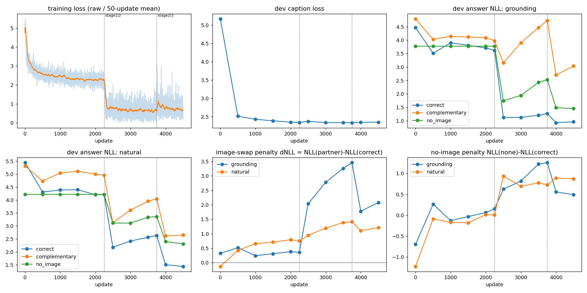
(dashed lines = stage boundaries)

## Final test: grounding suite (64 pairs / 128 questions)

Accuracy / pair-acc / identical / empty in %, with 95% pair-bootstrap CI (4000 resamples). NLL = mean token NLL of the original reference (teacher-forced, no end token). Natural accuracy = VQA soft consensus.


**all** (64 pairs)

| condition | accuracy | pair acc | identical ans. | empty | ref. NLL | gen s/answer |
|---|---|---|---|---|---|---|
| correct | 66.41 [57.81, 74.22] | 45.31 [32.81, 57.81] | 29.69 [18.75, 42.19] | 0.00 [0.00, 0.00] | 0.871 [0.663, 1.084] | 0.0223 |
| complementary | 15.62 [9.38, 21.88] | 1.56 [0.00, 4.69] | 29.69 [18.75, 42.19] | 0.00 [0.00, 0.00] | 3.305 [2.877, 3.774] | 0.0214 |
| mismatched | 30.47 [23.44, 37.50] | 6.25 [1.56, 12.50] | 54.69 [42.19, 67.19] | 0.00 [0.00, 0.00] | 2.334 [2.047, 2.628] | 0.0201 |
| no_image | 39.06 [33.59, 43.75] | 0.00 [0.00, 0.00] | 100.00 [100.00, 100.00] | 0.00 [0.00, 0.00] | 1.432 [1.238, 1.650] | 0.0195 |

Correct-image advantage over complementary swap: accuracy 50.78 [38.28, 63.28] pts; pair accuracy 43.75 [31.25, 56.25] pts; NLL (complementary - correct) 2.435 [1.861, 3.039].

| condition | n | matches own ref | matches partner ref | neither |
|---|---|---|---|---|
| correct | 128 | 85 | 20 | 23 |
| complementary | 128 | 20 | 85 | 23 |
| mismatched | 128 | 39 | 49 | 40 |
| no_image | 128 | 50 | 50 | 28 |

**presence** (32 pairs)

| condition | accuracy | pair acc | identical ans. | empty | ref. NLL | gen s/answer |
|---|---|---|---|---|---|---|
| correct | 82.81 [73.44, 92.19] | 68.75 [53.12, 84.38] | 28.12 [12.50, 43.75] | 0.00 [0.00, 0.00] | 0.437 [0.210, 0.697] | 0.0223 |
| complementary | 17.19 [7.81, 26.56] | 3.12 [0.00, 9.38] | 28.12 [12.50, 43.75] | 0.00 [0.00, 0.00] | 3.945 [3.247, 4.662] | 0.0214 |
| mismatched | 48.44 [39.06, 57.81] | 12.50 [3.12, 25.00] | 71.88 [56.25, 87.50] | 0.00 [0.00, 0.00] | 2.132 [1.672, 2.612] | 0.0201 |
| no_image | 50.00 [50.00, 50.00] | 0.00 [0.00, 0.00] | 100.00 [100.00, 100.00] | 0.00 [0.00, 0.00] | 0.880 [0.828, 0.934] | 0.0195 |

Correct-image advantage over complementary swap: accuracy 65.62 [46.88, 84.38] pts; pair accuracy 65.62 [46.88, 84.38] pts; NLL (complementary - correct) 3.508 [2.622, 4.389].

| condition | n | matches own ref | matches partner ref | neither |
|---|---|---|---|---|
| correct | 64 | 53 | 11 | 0 |
| complementary | 64 | 11 | 53 | 0 |
| mismatched | 64 | 31 | 33 | 0 |
| no_image | 64 | 32 | 32 | 0 |

**counting** (32 pairs)

| condition | accuracy | pair acc | identical ans. | empty | ref. NLL | gen s/answer |
|---|---|---|---|---|---|---|
| correct | 50.00 [39.06, 60.94] | 21.88 [9.38, 37.50] | 31.25 [15.62, 46.88] | 0.00 [0.00, 0.00] | 1.305 [1.049, 1.582] | 0.0223 |
| complementary | 14.06 [6.25, 21.88] | 0.00 [0.00, 0.00] | 31.25 [15.62, 46.88] | 0.00 [0.00, 0.00] | 2.666 [2.239, 3.140] | 0.0214 |
| mismatched | 12.50 [4.69, 20.31] | 0.00 [0.00, 0.00] | 37.50 [21.88, 53.12] | 0.00 [0.00, 0.00] | 2.535 [2.209, 2.889] | 0.0201 |
| no_image | 28.12 [18.75, 35.94] | 0.00 [0.00, 0.00] | 100.00 [100.00, 100.00] | 0.00 [0.00, 0.00] | 1.983 [1.694, 2.307] | 0.0195 |

Correct-image advantage over complementary swap: accuracy 35.94 [21.88, 50.04] pts; pair accuracy 21.88 [9.38, 37.50] pts; NLL (complementary - correct) 1.361 [0.832, 1.913].

| condition | n | matches own ref | matches partner ref | neither |
|---|---|---|---|---|
| correct | 64 | 32 | 9 | 23 |
| complementary | 64 | 9 | 32 | 23 |
| mismatched | 64 | 8 | 16 | 40 |
| no_image | 64 | 18 | 18 | 28 |

## Final test: natural suite (96 pairs / 192 questions)

Accuracy / pair-acc / identical / empty in %, with 95% pair-bootstrap CI (4000 resamples). NLL = mean token NLL of the original reference (teacher-forced, no end token). Natural accuracy = VQA soft consensus.


**all** (96 pairs)

| condition | accuracy | pair acc | identical ans. | empty | ref. NLL | gen s/answer |
|---|---|---|---|---|---|---|
| correct | 52.71 [45.94, 59.22] | 21.88 [14.58, 30.21] | 54.17 [43.75, 63.54] | 0.00 [0.00, 0.00] | 1.423 [1.140, 1.731] | 0.0295 |
| complementary | 31.56 [25.57, 37.92] | 4.17 [1.04, 8.33] | 54.17 [43.75, 63.54] | 0.00 [0.00, 0.00] | 2.799 [2.373, 3.259] | 0.0243 |
| mismatched | 32.03 [26.20, 37.86] | 4.17 [1.04, 8.33] | 58.33 [47.92, 68.75] | 0.00 [0.00, 0.00] | 2.598 [2.240, 2.996] | 0.0287 |
| no_image | 35.47 [30.26, 40.52] | 0.00 [0.00, 0.00] | 100.00 [100.00, 100.00] | 0.00 [0.00, 0.00] | 2.199 [1.819, 2.597] | 0.0248 |

Correct-image advantage over complementary swap: accuracy 21.15 [11.77, 30.63] pts; pair accuracy 17.71 [8.33, 27.08] pts; NLL (complementary - correct) 1.376 [0.993, 1.812].

| condition | n | matches own ref | matches partner ref | neither |
|---|---|---|---|---|
| correct | 192 | 94 | 54 | 44 |
| complementary | 192 | 54 | 94 | 44 |
| mismatched | 192 | 57 | 57 | 78 |
| no_image | 192 | 63 | 63 | 66 |

**yes/no** (36 pairs)

| condition | accuracy | pair acc | identical ans. | empty | ref. NLL | gen s/answer |
|---|---|---|---|---|---|---|
| correct | 60.42 [53.75, 67.36] | 13.89 [2.78, 27.78] | 80.56 [66.67, 91.67] | 0.00 [0.00, 0.00] | 0.832 [0.704, 0.962] | 0.0295 |
| complementary | 52.92 [45.69, 59.72] | 5.56 [0.00, 13.89] | 80.56 [66.67, 91.67] | 0.00 [0.00, 0.00] | 1.380 [1.143, 1.631] | 0.0243 |
| mismatched | 53.61 [48.19, 59.17] | 5.56 [0.00, 13.89] | 86.11 [75.00, 97.22] | 0.00 [0.00, 0.00] | 1.331 [1.135, 1.535] | 0.0287 |
| no_image | 55.00 [52.50, 57.92] | 0.00 [0.00, 0.00] | 100.00 [100.00, 100.00] | 0.00 [0.00, 0.00] | 0.906 [0.836, 0.986] | 0.0248 |

Correct-image advantage over complementary swap: accuracy 7.50 [-4.72, 20.42] pts; pair accuracy 8.33 [-5.56, 22.22] pts; NLL (complementary - correct) 0.548 [0.276, 0.854].

| condition | n | matches own ref | matches partner ref | neither |
|---|---|---|---|---|
| correct | 72 | 39 | 33 | 0 |
| complementary | 72 | 33 | 39 | 0 |
| mismatched | 72 | 35 | 36 | 1 |
| no_image | 72 | 36 | 36 | 0 |

**number** (24 pairs)

| condition | accuracy | pair acc | identical ans. | empty | ref. NLL | gen s/answer |
|---|---|---|---|---|---|---|
| correct | 45.42 [30.42, 60.21] | 25.00 [8.33, 41.67] | 37.50 [16.67, 58.33] | 0.00 [0.00, 0.00] | 1.728 [1.166, 2.404] | 0.0295 |
| complementary | 22.71 [11.67, 34.58] | 4.17 [0.00, 12.50] | 37.50 [16.67, 58.33] | 0.00 [0.00, 0.00] | 3.040 [2.386, 3.777] | 0.0243 |
| mismatched | 20.00 [10.42, 30.42] | 0.00 [0.00, 0.00] | 58.33 [37.50, 79.17] | 0.00 [0.00, 0.00] | 3.009 [2.406, 3.649] | 0.0287 |
| no_image | 35.21 [25.83, 44.17] | 0.00 [0.00, 0.00] | 100.00 [100.00, 100.00] | 0.00 [0.00, 0.00] | 2.260 [1.623, 3.065] | 0.0248 |

Correct-image advantage over complementary swap: accuracy 22.71 [1.67, 43.75] pts; pair accuracy 20.83 [0.00, 41.67] pts; NLL (complementary - correct) 1.312 [0.692, 1.963].

| condition | n | matches own ref | matches partner ref | neither |
|---|---|---|---|---|
| correct | 48 | 20 | 10 | 18 |
| complementary | 48 | 10 | 20 | 18 |
| mismatched | 48 | 9 | 12 | 27 |
| no_image | 48 | 16 | 16 | 16 |

**other** (36 pairs)

| condition | accuracy | pair acc | identical ans. | empty | ref. NLL | gen s/answer |
|---|---|---|---|---|---|---|
| correct | 49.86 [37.92, 61.94] | 27.78 [13.89, 41.67] | 38.89 [22.22, 55.56] | 0.00 [0.00, 0.00] | 1.810 [1.234, 2.482] | 0.0295 |
| complementary | 16.11 [8.19, 25.42] | 2.78 [0.00, 8.33] | 38.89 [22.22, 55.56] | 0.00 [0.00, 0.00] | 4.057 [3.247, 4.910] | 0.0243 |
| mismatched | 18.47 [9.72, 28.61] | 5.56 [0.00, 13.89] | 30.56 [16.67, 47.22] | 0.00 [0.00, 0.00] | 3.592 [2.901, 4.337] | 0.0287 |
| no_image | 16.11 [8.33, 24.44] | 0.00 [0.00, 0.00] | 100.00 [100.00, 100.00] | 0.00 [0.00, 0.00] | 3.453 [2.805, 4.185] | 0.0248 |

Correct-image advantage over complementary swap: accuracy 33.75 [18.06, 49.44] pts; pair accuracy 25.00 [8.33, 41.67] pts; NLL (complementary - correct) 2.247 [1.422, 3.111].

| condition | n | matches own ref | matches partner ref | neither |
|---|---|---|---|---|
| correct | 72 | 35 | 11 | 26 |
| complementary | 72 | 11 | 35 | 26 |
| mismatched | 72 | 13 | 9 | 50 |
| no_image | 72 | 11 | 11 | 50 |
## Qualitative complementary-image examples

Selection rule (deterministic, no cherry-picking by appearance): within each suite,
pairs are sorted by pair_id and the first k satisfying each category are shown:
  A 'follows image': correct-image predictions right for both questions AND under the
    complementary swap each prediction equals the partner image's reference;
  B 'ignores image': identical predictions for both images of the pair (correct condition);
  C 'fails': at least one wrong prediction under the correct image.

### grounding - A follows image (29 qualifying pairs; showing 3)

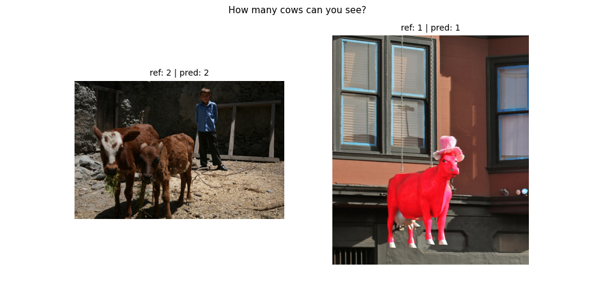

Question: *How many cows can you see?*

| item | reference | correct | complementary | mismatched | no image |
|---|---|---|---|---|---|
| image A | 2 | 2 | 1 | 0 | 1 |
| image B | 1 | 1 | 2 | 0 | 1 |


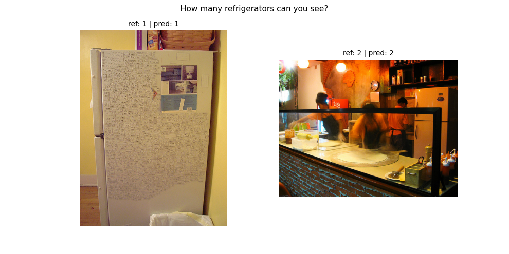

Question: *How many refrigerators can you see?*

| item | reference | correct | complementary | mismatched | no image |
|---|---|---|---|---|---|
| image A | 1 | 1 | 2 | 1 | 1 |
| image B | 2 | 2 | 1 | 0 | 1 |


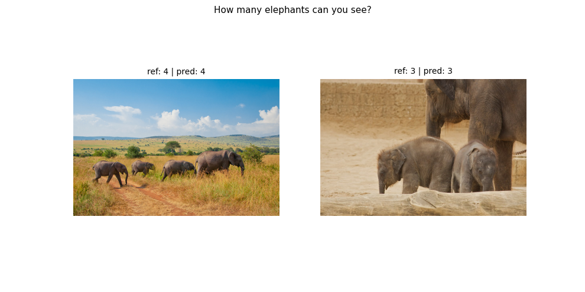

Question: *How many elephants can you see?*

| item | reference | correct | complementary | mismatched | no image |
|---|---|---|---|---|---|
| image A | 4 | 4 | 3 | 1 | 1 |
| image B | 3 | 3 | 4 | 0 | 1 |

### grounding - B ignores image (19 qualifying pairs; showing 3)

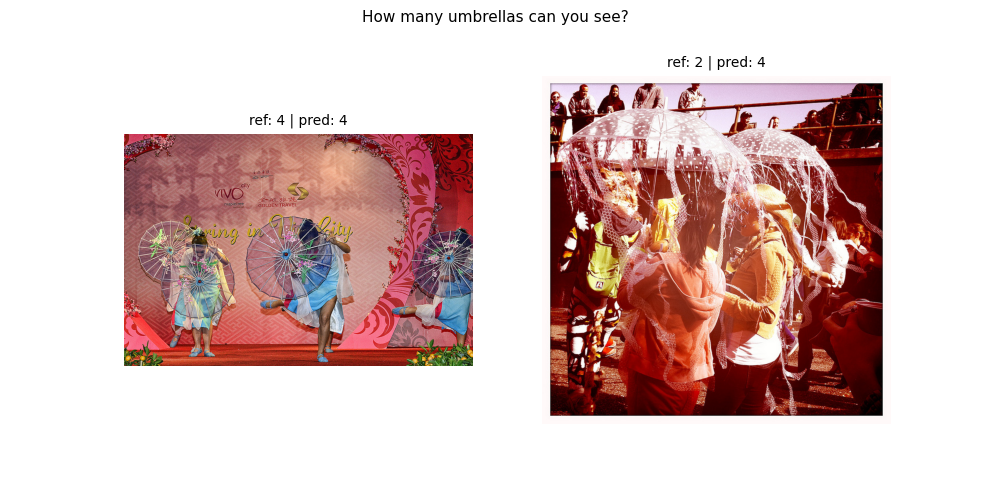

Question: *How many umbrellas can you see?*

| item | reference | correct | complementary | mismatched | no image |
|---|---|---|---|---|---|
| image A | 4 | 4 | 4 | 1 | 1 |
| image B | 2 | 4 | 4 | 1 | 1 |


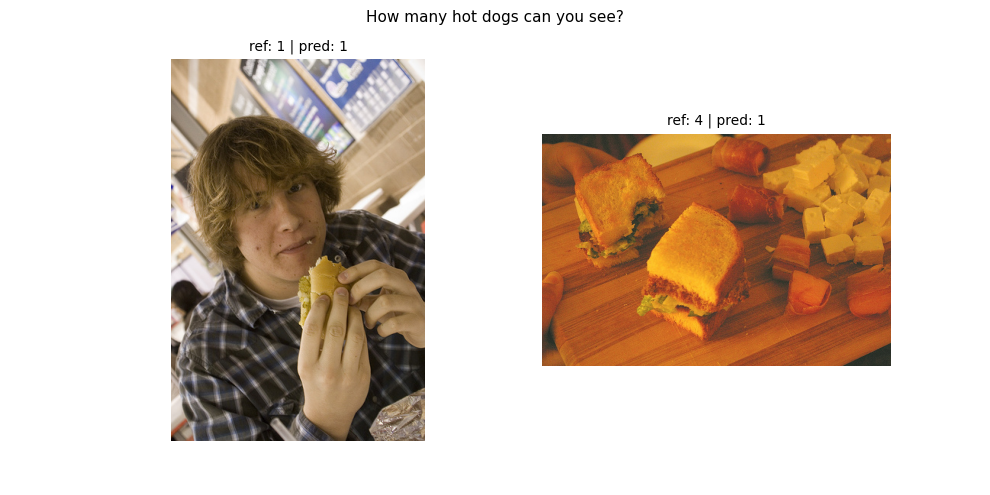

Question: *How many hot dogs can you see?*

| item | reference | correct | complementary | mismatched | no image |
|---|---|---|---|---|---|
| image A | 1 | 1 | 1 | 0 | 1 |
| image B | 4 | 1 | 1 | 1 | 1 |


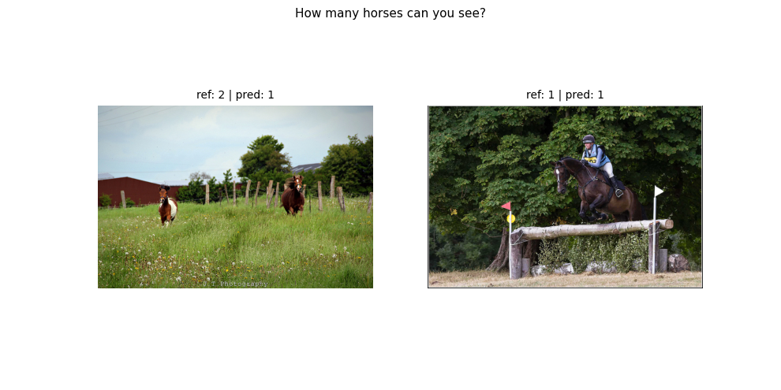

Question: *How many horses can you see?*

| item | reference | correct | complementary | mismatched | no image |
|---|---|---|---|---|---|
| image A | 2 | 1 | 1 | 0 | 1 |
| image B | 1 | 1 | 1 | 0 | 1 |

### grounding - C fails (35 qualifying pairs; showing 3)


Question: *How many umbrellas can you see?*

| item | reference | correct | complementary | mismatched | no image |
|---|---|---|---|---|---|
| image A | 4 | 4 | 4 | 1 | 1 |
| image B | 2 | 4 | 4 | 1 | 1 |


Question: *How many hot dogs can you see?*

| item | reference | correct | complementary | mismatched | no image |
|---|---|---|---|---|---|
| image A | 1 | 1 | 1 | 0 | 1 |
| image B | 4 | 1 | 1 | 1 | 1 |


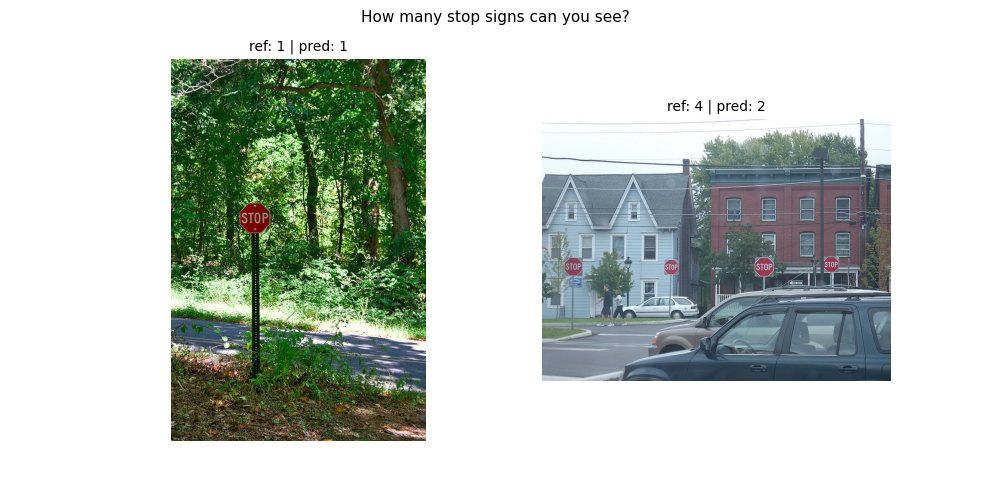

Question: *How many stop signs can you see?*

| item | reference | correct | complementary | mismatched | no image |
|---|---|---|---|---|---|
| image A | 1 | 1 | 2 | 3 | 1 |
| image B | 4 | 2 | 1 | 1 | 1 |

### natural - A follows image (21 qualifying pairs; showing 3)

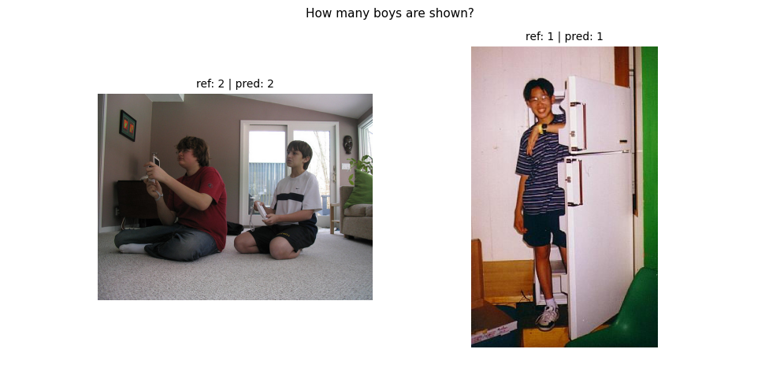

Question: *How many boys are shown?*

| item | reference | correct | complementary | mismatched | no image |
|---|---|---|---|---|---|
| image A | 2 | 2 | 1 | 0 | 1 |
| image B | 1 | 1 | 2 | 0 | 1 |


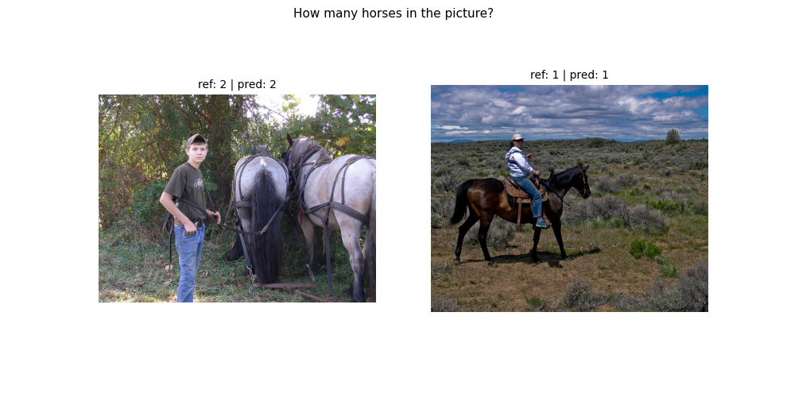

Question: *How many horses in the picture?*

| item | reference | correct | complementary | mismatched | no image |
|---|---|---|---|---|---|
| image A | 2 | 2 | 1 | 0 | 1 |
| image B | 1 | 1 | 2 | 0 | 1 |


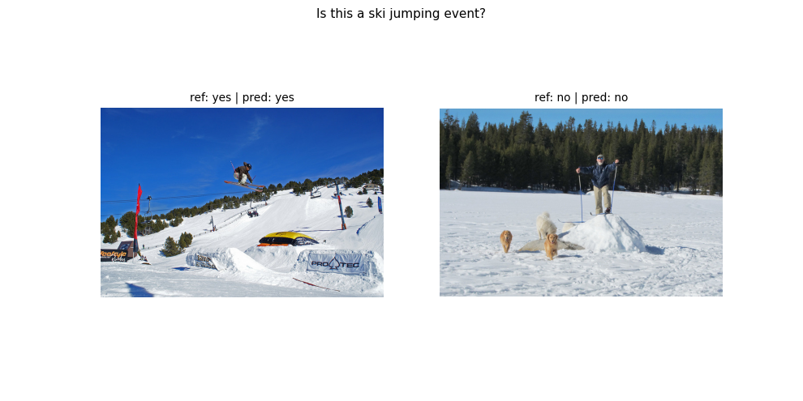

Question: *Is this a ski jumping event?*

| item | reference | correct | complementary | mismatched | no image |
|---|---|---|---|---|---|
| image A | yes | yes | no | no | no |
| image B | no | no | yes | no | no |

### natural - B ignores image (52 qualifying pairs; showing 3)

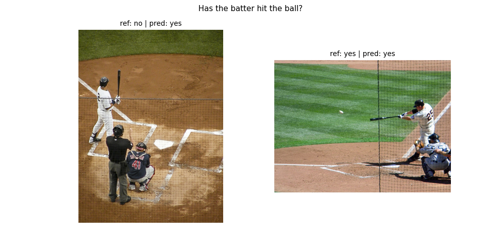

Question: *Has the batter hit the ball?*

| item | reference | correct | complementary | mismatched | no image |
|---|---|---|---|---|---|
| image A | no | yes | yes | no | no |
| image B | yes | yes | yes | no | no |


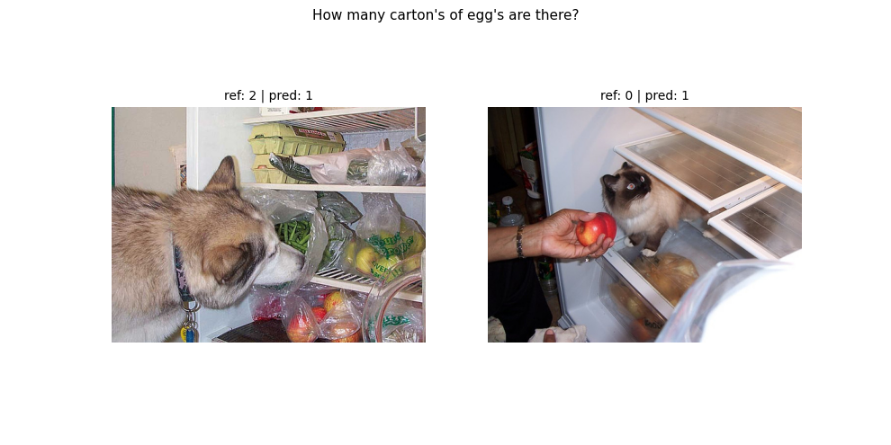

Question: *How many carton's of egg's are there?*

| item | reference | correct | complementary | mismatched | no image |
|---|---|---|---|---|---|
| image A | 2 | 1 | 1 | 0 | 1 |
| image B | 0 | 1 | 1 | 0 | 1 |


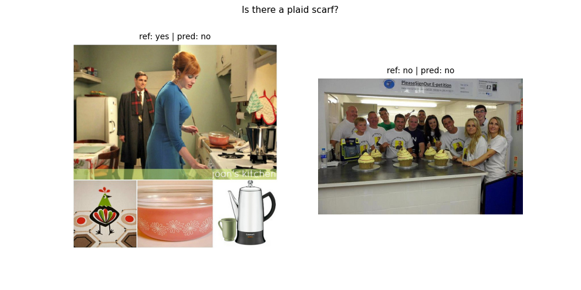

Question: *Is there a plaid scarf?*

| item | reference | correct | complementary | mismatched | no image |
|---|---|---|---|---|---|
| image A | yes | no | no | no | no |
| image B | no | no | no | no | no |

### natural - C fails (75 qualifying pairs; showing 3)


Question: *Has the batter hit the ball?*

| item | reference | correct | complementary | mismatched | no image |
|---|---|---|---|---|---|
| image A | no | yes | yes | no | no |
| image B | yes | yes | yes | no | no |


Question: *How many carton's of egg's are there?*

| item | reference | correct | complementary | mismatched | no image |
|---|---|---|---|---|---|
| image A | 2 | 1 | 1 | 0 | 1 |
| image B | 0 | 1 | 1 | 0 | 1 |


Question: *Is there a plaid scarf?*

| item | reference | correct | complementary | mismatched | no image |
|---|---|---|---|---|---|
| image A | yes | no | no | no | no |
| image B | no | no | no | no | no |

## Resources

- Feature caching (separate from training): 94 s, peak GPU 0.69 GB, 8729+528 images.

| stage | trainable params | training s | peak GPU GB |
|---|---|---|---|
| 1 | 1,837,056 (connector 1,837,056, LoRA 0) | 1270 | 1.78 |
| 2 | 6,424,576 (connector 1,837,056, LoRA 4,587,520) | 1300 | 1.77 |
| 3 | 6,424,576 (connector 1,837,056, LoRA 4,587,520) | 649 | 1.71 |

Dev-evaluation time during training: 55 s.
Final evaluation: 47 s wall, peak GPU 1.44 GB.

## Analysis notes (fill in after reading the tables above)
- Image use: compare correct vs complementary / mismatched / no-image accuracy and NLL.
- Answer consistency: identical-answer rate and the own/partner/neither table show whether a swap moves predictions toward the partner's answer or yields unsupported answers.
- Limitations: tiny test sets (64 / 96 pairs), wide CIs, one seed, template-derived grounding labels, local VQA scoring; teacher-forced NLL and greedy generation are different measures.